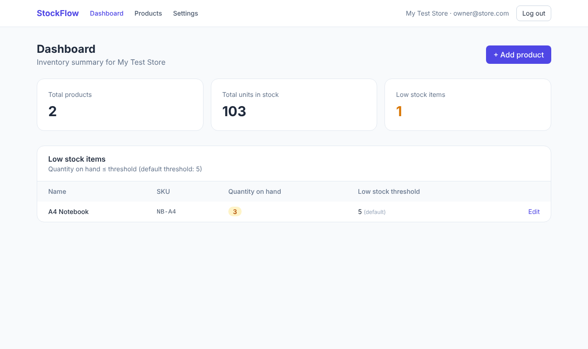

# StockFlow — SaaS Inventory Management MVP

A minimal multi-tenant inventory app built with **Python (Django)**. Each user signs up with their own organization, manages products and stock, and sees a dashboard with low-stock alerts. One organization can never see another organization's data.

**Live demo:** (https://stockflow-7tbo.onrender.com)



## Features

| PRD requirement | Implemented |
|---|---|
| FR-1 Signup & login | Email + password + confirm password + organization name; passwords hashed (PBKDF2, Django default) |
| FR-2 Organization context | Signup creates an `Organization`; every product query is filtered by the user's organization |
| FR-3 Product model | Name, SKU (unique per org), description, quantity, cost/selling price, low-stock threshold, timestamps, `last_updated_by` |
| FR-4 Product CRUD | Create / list / edit / delete (with confirm dialog); search by name or SKU |
| FR-5 Stock updates | Edit quantity in the form, or inline "+/- N units + note" adjust (can't go below 0) |
| FR-6 Dashboard | Total products, total units, low-stock count, low-stock table |
| FR-7 Settings | Default low-stock threshold (used when a product's threshold is empty) |

## Tech stack

- **Backend:** Python 3, Django 5.2 (built-in auth with server-side sessions, ORM, CSRF protection)
- **Database:** PostgreSQL in production, SQLite locally (via `DATABASE_URL`)
- **Frontend:** Django templates + Tailwind CSS (pre-compiled to `static/css/app.css`)
- **Deployment:** Render (Gunicorn + WhiteNoise for static files)

## Run locally

```bash
git clone <your-repo-url>
cd stockflow
python -m venv venv
# Windows: venv\Scripts\activate     Mac/Linux: source venv/bin/activate
pip install -r requirements.txt
python manage.py migrate
python manage.py runserver
```

Open http://127.0.0.1:8000, sign up, and start adding products.

Run the tests (14 tests, including cross-tenant isolation):

```bash
python manage.py test
```

## Deploy to Render (free)

1. Push this repo to GitHub.
2. On https://render.com → **New → Blueprint** → select the repo.
3. Render reads `render.yaml` and creates the web service and a free PostgreSQL database. `build.sh` installs dependencies, collects static files and runs migrations.
4. When it's live, open the `https://stockflow-xxxx.onrender.com` URL.

## Design decisions

- **Multi-tenancy:** shared database, with an `organization_id` foreign key on every product. Views only fetch products through `Product.objects.for_org(org)` or `get_object_or_404(Product, pk=..., organization=org)`. So requesting another org's product ID returns **404**, never the data.
- **SKU uniqueness:** enforced by a database constraint `UNIQUE(organization, sku)` and checked in the form for a friendly error. SKUs are stored uppercase.
- **Low stock logic:** `quantity_on_hand <= COALESCE(product.low_stock_threshold, org.default_low_stock_threshold)`, computed in the database query.
- **Stock adjustments** run in a transaction with `select_for_update()` to avoid race conditions.
- **Security:** hashed passwords, CSRF tokens on all forms, delete/adjust are POST-only, secure cookies in production.

## Project structure

```
stockflow/        settings, urls, wsgi
inventory/        models, forms, views, urls, admin, tests
templates/        base layout, auth pages, dashboard, products, settings
static/css/       compiled Tailwind CSS
build.sh          Render build script
render.yaml       Render blueprint (web + Postgres)
```

## Out of scope (per PRD)

Multi-warehouse, variants, integrations, orders, purchase orders, emails, CSV import, API, roles, audit logs, billing.
